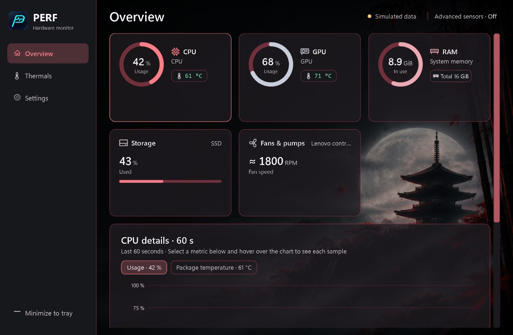
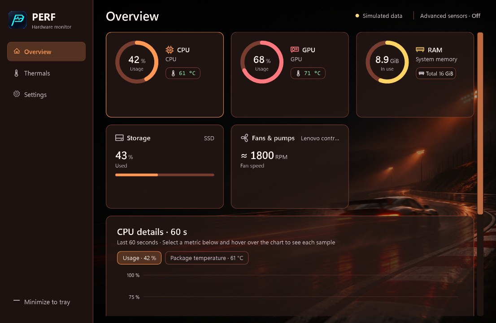
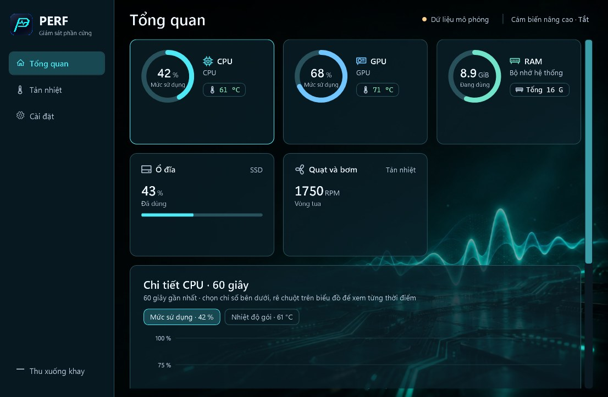
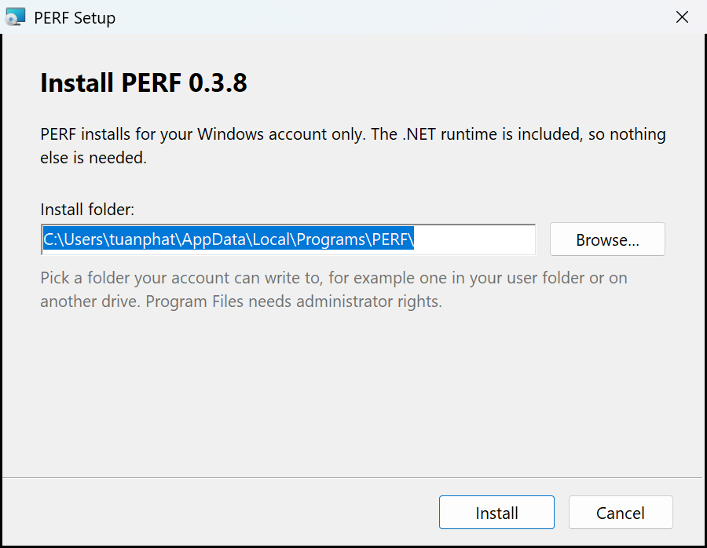

# PERF 0.4.0

  

  <b>A clean, lightweight hardware monitor for Windows.</b> 
  CPU, GPU, RAM, storage, fans, battery and network in one window, with five illustrated themes, 
  an always-on-top mini overlay, a 30-second temperature check and a self-reverting CPU cool-down.

  
  
  
  

  <a href="https://github.com/tuanphat67/PERF/releases/latest"><b>⬇ Download PERF for Windows</b></a>
  &nbsp;·&nbsp; <a href="#install-in-one-minute">Install</a>
  &nbsp;·&nbsp; <a href="#five-themes">Themes</a>
  &nbsp;·&nbsp; <a href="#faq">FAQ</a>

> **English and Vietnamese:** PERF picks English or Vietnamese from your Windows display language on first launch. Switch any time under **Settings → Appearance → Language**.

---

## Highlights

| | |
|---|---|
| 📊 **Everything at a glance** | CPU, GPU, RAM, storage, fans and pumps, battery and network on one dashboard, with a 1-minute, 10-minute or 1-hour chart and per-moment values on hover. |
| ⏺️ **Record to CSV** | Click **Record** while you game or render, then open the CSV in Excel to compare sessions. |
| 🌡️ **Temperature in the tray** | The tray icon shows your CPU temperature live, turning green, amber or red as it nears your warning threshold. |
| 🔔 **Smart alerts** | Get a Windows notification when the CPU or GPU stays above your threshold, the battery runs low or a drive is almost full. |
| 🪟 **Always-on-top mini overlay** | Sits in a screen corner or anywhere you drag it, on any display, and is click-through, so it never gets in the way of games or work. Show or hide it from anywhere with **Ctrl + Shift + O**. |
| 🔍 **What's using my PC?** | Click the CPU, GPU or RAM tile to see the five apps using the most, grouped by name. |
| 🎮 **Quick profiles** | Right-click the tray icon to switch between **Gaming** (overlay on, recording) and **Work** (overlay off). |
| 🎨 **Five illustrated themes** | PERF Classic, Cosmos, Astronaut, Shinobi and Night Racer, each with its own artwork, icon and colour palette. |
| 🌐 **English and Vietnamese** | Switch the whole interface, overlay and tray menu instantly, no restart needed. |
| 🔄 **One-click updates** | The version tag in the corner tells you when a new release is out and what's new in it. Click **Update now** and PERF downloads, verifies and installs it, then reopens. |
| ❤️ **PC health** | See when Windows slows your CPU down and why (heat, battery or power limits), check every drive's health, see how much capacity your laptop battery has left, and compare the last 7 days. |
| 🌡️ **Measure and cool down** | Record temperatures for 30 seconds under your real workload. Cap the CPU at 60, 75 or 90% for 10 minutes, then it restores itself. |
| 🔒 **Honest and safe** | No made-up numbers: sensors that report nothing show *Not available*. PERF collects no personal data and never drives your fans. |
| 🪶 **Lightweight** | Under 1% CPU while running in the background on our test laptop. Minimises to the system tray. |

## Five themes

Switch under **Settings → Appearance**, preview instantly, then click **Save settings**. The language selector lives in the same panel.

  

<table>
  <tr>
    <td width="50%"> <b>🪐 Cosmos</b>: a ringed gas giant, violet nebula and a deep star field.</td>
    <td width="50%"> <b>👨‍🚀 Astronaut</b>: Earth's night-side horizon seen from a space station.</td>
  </tr>
  <tr>
    <td> <b>🥷 Shinobi</b>: a full moon over a misty pagoda and bamboo.</td>
    <td> <b>🏎️ Night Racer</b>: a rain-soaked night circuit streaked with tail lights.</td>
  </tr>
  <tr>
    <td> <b>📈 PERF Classic</b>: glowing circuit traces and a cyan oscilloscope wave.</td>
    <td align="center"> Every theme ships with its own 3D icon.</td>
  </tr>
</table>

> The theme screenshots use simulated data so every tile is filled. On a real machine, readings depend on the sensors your hardware exposes.

## Chart history and session recording

- **Chart range:** above the chart on the Overview page, pick **1 min**, **10 min** or **1 hour**. PERF keeps the last hour of every sensor in memory from the moment it opens, even while it sits in the tray.
- **Record:** click **● Record** to start writing every sensor to a CSV file once per sample. The button turns into **■ Stop** with the elapsed time; recording keeps going while PERF is in the tray. Click **Stop** when you're done.
- **Where the file goes:** `Documents\PERF\PERF-<date>-<time>.csv` by default. Click **Open folder** under the chart to find it, or pick another folder under **Settings → Storage**.
- **File format:** one row per sample with `Time`, `Elapsed (s)` and one column per sensor, named *Device | Sensor (unit)*. Numbers use a dot as the decimal separator. An empty cell means the sensor had no reading at that moment, which is different from a real 0. Sensors that appear after you start recording are not added.

> Tip: record a few minutes of the same game before and after cleaning your fans or repasting the CPU, then compare the `CPU Package (°C)` columns.

## Storage locations

Open **Settings → Storage** to choose where PERF saves files, then click **Save settings**.

| What | Default | Can change |
|---|---|---|
| Session recordings (CSV) | `Documents\PERF` | ✅ Saved directly in the folder you pick |
| Downloaded update installers | `%LocalAppData%\PERF\updates` | ✅ Saved in a `PERF-updates` subfolder of the folder you pick |
| Settings and CPU cool-down sessions | `%LocalAppData%\PERF` | ❌ Fixed, so PERF can find them at startup and restore your power plan after a crash |

- PERF checks that it can write to a folder before accepting it.
- **Use default** switches back to the default location.
- Old update installers are cleaned up only inside the `PERF-updates` subfolder, never in the folder you picked itself.
- Changing a folder doesn't move files that are already saved.
- **Settings → Restore defaults** also resets both folders.

## Top apps

Click the **CPU**, **GPU** or **RAM** tile on the Overview page. Below the chart, **Top apps by CPU**, **Top apps by GPU** or **Top apps by RAM** lists the five apps using the most right now. GPU usage comes from the same Windows counters Task Manager uses; for each app PERF shows its busiest GPU engine (3D, video decode and so on). Processes with the same name are added together (a browser with 20 helper processes shows as one row, marked *×20*). PERF only measures processes while this card is on screen.

> Apps running as administrator may be missing while PERF itself runs without admin rights. Enable advanced mode to see them.

## Quick profiles

Right-click the PERF tray icon and pick a profile. The active one has a tick.

| Profile | What it does |
|---|---|
| **Gaming** | Shows the mini overlay (top right if it was off, CPU/GPU/RAM if no metric was chosen), turns heat alerts on and starts **recording** to CSV. |
| **Work** | Hides the mini overlay and stops recording. |

A notification confirms the switch. Changing settings by hand and clicking **Save settings** clears the tick.

## First-run tour

The first time you open PERF 0.3.11 or later, a four-step tour shows the Overview, the mini overlay and its hotkey, the tray and alerts, and where to customise PERF. **Skip** closes it; replay it any time from **Settings → Startup → Replay quick tour**.

## Tray temperature and alerts

- **Live tray icon:** the PERF icon in the system tray becomes a small tile with the current temperature. It follows **Settings → Sampling & alerts → Pinned metric** when that metric is a temperature, otherwise the CPU. Hover it for the exact reading.

  | Colour | Meaning |
  |---|---|
  | 🟢 Green | Below *threshold − 5 °C* |
  | 🟡 Amber | Within 5 °C of the threshold |
  | 🔴 Red | At or above the threshold |

- **Heat alerts:** set a **Warning threshold** (40–110 °C) and **Time above threshold** (5–60 s). When the CPU or GPU stays that hot for that long, Windows shows a notification. Click it to open **Thermals**. You get one alert per hot spell; it re-arms after the temperature drops back.
- **Low battery:** on a laptop running on battery, PERF notifies you once when the charge reaches **Low battery alert** (10, 15, 20 or 30%, default 20%). It re-arms after you plug in.
- **Low disk space:** every minute PERF checks internal drives and notifies you once per drive when free space drops below **Low disk space alert** (5, 10 or 15%, default 10%).
- Click a battery or disk notification to open the matching details on the Overview page. Set either alert to **Off** to disable it.
- Temperature alerts and the tray temperature are on by default. Turn them off with **Show temperature on the tray icon** and **Notify me when the CPU / GPU stays above the threshold**, then click **Save settings**.

> Can't see the icon? Windows may hide new tray icons. Open **Windows Settings → Personalization → Taskbar → Other system tray icons** and turn **PERF** on.

## Mini overlay

A small always-on-top window in the corner of your screen. By default it shows CPU, GPU and RAM usage plus temperatures when available. Choose **Compact rows**, **Horizontal strip** or **Usage bars** and adjust position, size, background opacity and one to three metrics under **Settings → Mini overlay**. **Use theme overlay preset** fills in a layout that matches the current theme.

**Move it anywhere:** click **Move...** next to **Position**. The overlay jumps to the middle of the display that shows the PERF window and says *Drag to move*. Drag it as many times as you like, including onto another display; it snaps to the screen edges when you get close. Then click **Done** (the Move button changes to Done), double-click the overlay or press **Enter** to save. **Esc** puts it back where it was. **Position** switches to **Custom position**. If that display is later disconnected, the overlay returns to the top-right corner. Pick a corner again at any time to go back.

**Hotkey:** press **Ctrl + Shift + O** anywhere, even in a game, to show or hide the overlay. Pick another combination (or **Off**) under **Settings → Mini overlay → Show/hide hotkey**. If the overlay's position is set to **Off**, the hotkey shows it in the top-right corner until you press it again. Clicking **Save settings** returns the overlay to the position you chose. If another app already uses the combination, PERF tells you when you save; pick a different one.

  

## Temperature check and CPU cool-down

- **Temperature check:** start a measurement while a game or heavy task is running. PERF records the starting, current and peak temperature over 30 seconds. It never generates load on its own.
- **Temporary CPU cool-down:** cap the maximum processor state at **60%, 75% or 90%** for 10 minutes, on both AC and battery power.
- **Always reverted:** PERF edits a copy of your power plan and restores the original when time runs out or when you quit, even after a crash or power loss. **Restore previous power plan** undoes it immediately.
- **Fans and pumps:** the **Fans and pumps** card shows every RPM and PWM channel your machine reports. Fans stay under firmware or vendor-software control. On Lenovo laptops, PERF also reads fan speed through Lenovo WMI.

 

## PC health

The **Health** page answers "is my PC OK?" without administrator rights:

- **CPU performance:** how much of its maximum performance Windows currently lets the CPU use, plus the effective clock speed. When this drops while the CPU is busy for a few seconds, PERF logs a **slowdown** with the time, how long it lasted, the lowest level and the likely cause: high temperature, battery or power saving, or a power limit / power plan. PERF's own CPU cool-down is never counted.
- **Drive health:** every physical drive with the status Windows reports (**Healthy**, **Warning**, **Failing**). If a drive reports a problem, PERF notifies you once so you can back up. Wear in percent appears when advanced sensors are on.
- **Battery health (laptops):** how much of its design capacity the battery still holds, with the full-charge and design capacity.
- **Last 7 days:** for each day PERF was running, the highest CPU and GPU temperature, average CPU load, number and total length of slowdowns, and time on battery. The summary is stored only on your PC (`%LocalAppData%\PERF\history.json`, last 30 days).

## Install in one minute

1. **Download** `PERF-<version>-x64.msi` from [**Releases**](https://github.com/tuanphat67/PERF/releases/latest) (under **Assets**). This is the only official source.
2. **Run the installer.** Windows will most likely warn you first, because the installer is not code-signed yet. Follow [Get past the Windows warning](#get-past-the-windows-warning) below, then continue here. PERF installs for your Windows account only, and the .NET runtime is bundled, so nothing else is needed.
3. **Choose where to install:** keep the default `%LocalAppData%\Programs\PERF` or click **Browse...** to pick another folder (for example on drive D:) in the standard Windows folder picker. Pick a folder your account can write to; Program Files needs administrator rights.
4. On the last screen, leave **Open PERF now** ticked to start PERF right away, or untick it and launch **PERF** from the Start menu later.

 

Updates, including one-click updates from inside PERF, install to the same folder you chose. Running the installer again on a PC that already has PERF offers **Repair** or **Remove**.

### Get past the Windows warning

PERF is free and not code-signed (a signing certificate costs money every year), so Windows SmartScreen does not recognise the installer yet. You only need to allow **this one file**; there is no need to turn SmartScreen off for your whole PC.

**If your browser blocks the download** (Microsoft Edge: *"PERF-…msi isn't commonly downloaded"*):
1. In the downloads list, hover over the file and click **⋯ (More actions)** → **Keep**.
2. Click **Show more** → **Keep anyway**.

In Chrome, click **Keep** (or **⋮ → Download dangerous file**) in the download bar.

**If a blue "Windows protected your PC" window appears when you open the installer:**
1. Click **More info**.
2. Check that it says *File: PERF-<version>-x64.msi*, then click **Run anyway**.

**Alternative (before opening the file):** right-click the downloaded `.msi` → **Properties** → at the bottom of the **General** tab tick **Unblock** → **OK**. Windows then opens it without the SmartScreen window.

> **Why not turn SmartScreen off completely?** It also protects you from real malware in other downloads. Allowing just the PERF installer gets the same result without leaving your PC unprotected. If you already turned it off, you can switch it back on in **Windows Security → App & browser control → Reputation-based protection**.

> **Smart App Control (Windows 11):** if Windows says *"Smart App Control blocked an app that may be unsafe"* and offers no **Run anyway** button, Smart App Control is on. It blocks every unsigned installer and cannot be bypassed per file. Check it in **Windows Security → App & browser control → Smart App Control settings**. Turning it off is a one-way switch (turning it back on needs a Windows reset), so only do it if you are comfortable with that.

**Advanced sensors (recommended):** the installer includes the signed **PawnIO** driver, which unlocks extra CPU temperature and power readings. Keep **Install the PawnIO driver** ticked on the first screen and accept the UAC prompt when asked. The option is hidden when PawnIO is already installed. If you skipped it, open **Settings → Sensor sources**, click **Install bundled PawnIO**, then quit and reopen PERF.

**Update:** the version tag at the bottom of the sidebar shows **Latest** or **Update to x.y.z**. When PERF finds a new version in the background it also shows a notification; click it to open the update dialog. The dialog lists **What's new** in your language. Click **Update now**: PERF downloads the new installer from GitHub, checks its SHA-256, closes cleanly, installs and reopens. You can also quit PERF and run a newer installer by hand. Your settings are kept either way.

**Uninstall:** quit PERF, then remove it from **Settings → Apps → Installed apps** in Windows.

### Requirements

- Windows 10 or 11, 64-bit (x64).
- Laptop or desktop. Available readings depend on your hardware and drivers.

## Tips

- Click **X** to send PERF to the system tray; the overlay and the tray temperature keep updating. Double-click the tray icon to bring it back.
- Pin a GPU or SSD temperature under **Settings → Sampling & alerts → Pinned metric** to show it on the tray icon instead of the CPU.
- Click the **Fans and pumps** card to see every RPM and PWM channel; **Reset min/max** starts the session statistics over.
- On the chart, pick a metric below it and hover to read any moment. Switch to **1 hour** to see a whole gaming session.
- **Settings → Restore defaults** resets every option and returns your power plan to how it was.

## FAQ

<b>Why does GPU temperature show "– °C"?</b>

Usually because the machine only has integrated graphics (for example Intel UHD Graphics). The iGPU shares the CPU die and has no temperature sensor of its own, so PERF leaves it blank instead of guessing. Discrete NVIDIA and AMD GPUs report their temperature normally.

<b>Why do some tiles say "Not available"?</b>

Your drivers or firmware don't expose that reading. Installing **PawnIO** and allowing advanced mode unlocks more CPU temperature and power sensors. Some GPU, SSD and fan readings still depend on the device.

<b>How do I report a problem?</b>

Open **Settings → Sensor sources** and click **Copy diagnostic report**. It copies the PERF and Windows versions, sensor sources, current readings and the last 40 lines of PERF's error log, with your user name, machine name and user-folder path removed. Paste it into a new issue on [GitHub Issues](https://github.com/tuanphat67/PERF/issues) together with what you expected and what happened.

<b>Does PERF control fans or overclock?</b>

No. PERF only reads sensors. The cool-down feature temporarily lowers the maximum processor state through the Windows power plan and always reverts it.

<b>Does PERF collect my data or phone home?</b>

No. The only network request PERF makes is a version check against this repository's public GitHub Releases (about 45 seconds after launch, then every 12 hours) and the installer download when you choose to update. No hardware data or personal information is sent. Turn off **Check for updates automatically** in Settings to stop the background check. Settings are stored locally in `%LocalAppData%\PERF`. PERF also keeps a small local error log in `%LocalAppData%\PERF\logs` (at most about 1 MB, user name and paths removed) that never leaves your PC unless you paste a diagnostic report yourself.

<b>Windows SmartScreen warns about the installer</b>

The PERF installer is not code-signed yet, so Windows may show a warning. Only download PERF from the official Releases page, then allow just that file: see [Get past the Windows warning](#get-past-the-windows-warning) for Edge, Chrome, the blue SmartScreen window and Smart App Control.

<b>A cool-down session seems stuck after a sudden shutdown</b>

Open PERF or sign in to Windows again and the recovery runs automatically. If it still isn't restored, open `%LocalAppData%\PERF\cooling.json`, copy the value of `Original`, and run `powercfg /setactive <value>` in PowerShell, or pick your previous plan in Power Options.

## License

PERF is **free software with all rights reserved** by its author. You may download the official installer from Releases and use it free of charge. Copying, modifying, redistributing or selling PERF, its code, artwork or icons is not permitted without the author's written permission. See [LICENSE](LICENSE).

PERF bundles third-party components that keep their own licenses: LibreHardwareMonitorLib (MPL-2.0), HidSharp, the .NET runtime and the PawnIO installer. See [THIRD-PARTY.txt](THIRD-PARTY.txt).
