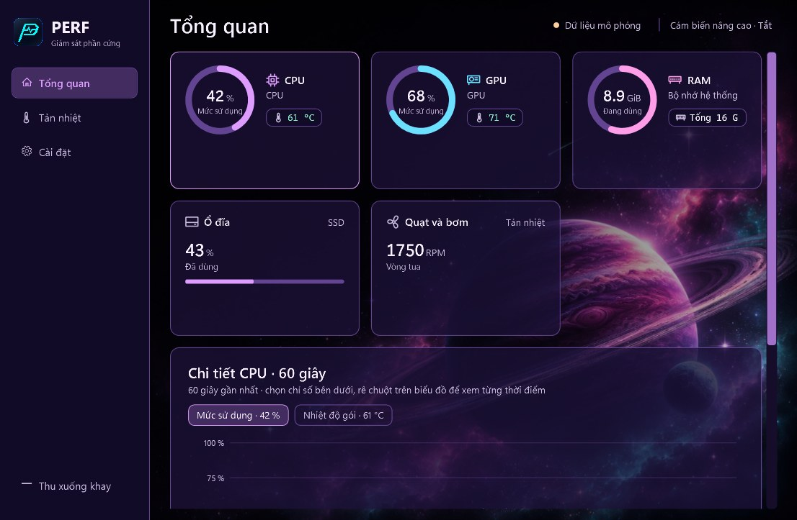
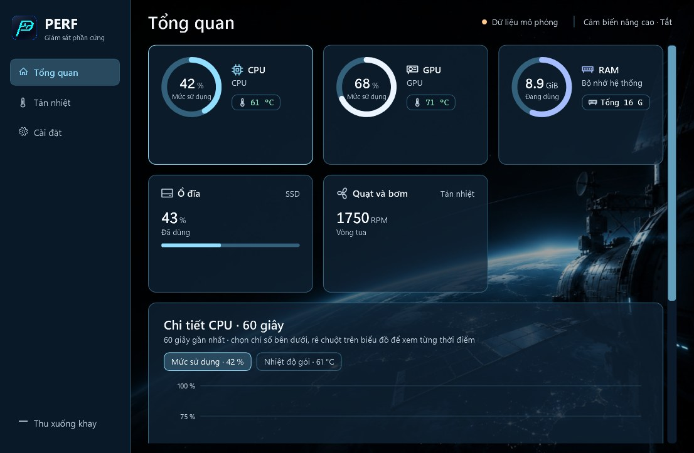
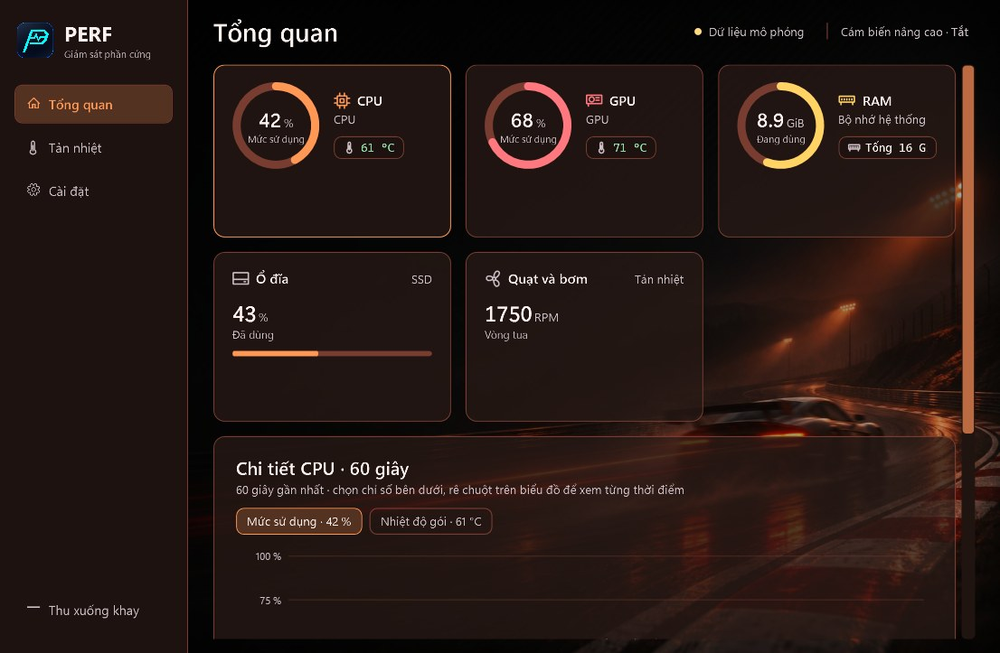
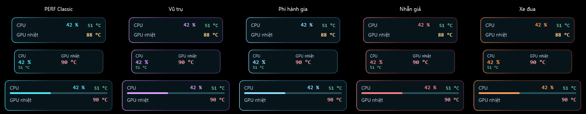
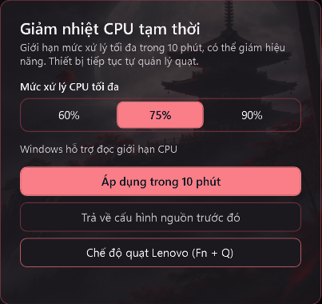

# PERF 0.3.2

  

  <b>Theo dõi CPU, GPU, RAM, ổ đĩa, quạt, pin và mạng trên Windows trong một cửa sổ đẹp, nhẹ và dễ đọc.</b> 
  Năm chủ đề minh họa, cửa sổ theo dõi nhỏ luôn nổi, đo nhiệt độ 30 giây và giảm nhiệt CPU tạm thời có tự hoàn tác.

  
  
  

  <a href="https://github.com/tuanphat67/PERF/releases/latest"><b>⬇ Tải PERF cho Windows</b></a>
  &nbsp;·&nbsp; <a href="#cài-đặt-trong-1-phút">Cài đặt</a>
  &nbsp;·&nbsp; <a href="#năm-chủ-đề">Chủ đề</a>
  &nbsp;·&nbsp; <a href="#câu-hỏi-thường-gặp">Hỏi đáp</a>

---

## Vì sao chọn PERF

| | |
|---|---|
| 📊 **Mọi chỉ số trên một màn hình** | CPU, GPU, RAM, ổ đĩa, quạt và bơm, pin, mạng, kèm biểu đồ 60 giây và giá trị chi tiết khi rê chuột. |
| 🪟 **Cửa sổ nhỏ luôn nổi** | Đặt ở góc màn hình, chuột bấm xuyên qua nên không vướng khi chơi game hay làm việc. |
| 🎨 **Năm chủ đề minh họa** | PERF Classic, Vũ trụ, Phi hành gia, Nhẫn giả và Xe đua, mỗi chủ đề có ảnh nền, biểu tượng và bảng màu riêng. |
| 🌡️ **Đo và giảm nhiệt** | Đo nhiệt độ trong 30 giây khi bạn chạy tác vụ thật. Giới hạn CPU 60, 75 hoặc 90% trong 10 phút, tự trả về như cũ. |
| 🔒 **Trung thực và an toàn** | Không đoán số: cảm biến nào không có thì hiện *Chưa đọc được*. PERF không gửi dữ liệu đi đâu và không điều khiển quạt. |
| 🪶 **Nhẹ** | Dưới 1% CPU khi chạy nền trên laptop thử nghiệm. Thu xuống khay hệ thống khi không cần. |

## Năm chủ đề

Đổi trong **Cài đặt → Giao diện**, xem trước ngay rồi bấm **Lưu cài đặt**.

  

<table>
  <tr>
    <td width="50%"> <b>🪐 Vũ trụ</b>: hành tinh có vành, tinh vân tím hồng và trường sao.</td>
    <td width="50%"> <b>👨‍🚀 Phi hành gia</b>: chân trời Trái Đất ban đêm nhìn từ trạm vũ trụ.</td>
  </tr>
  <tr>
    <td> <b>🥷 Nhẫn giả</b>: trăng tròn, chùa cổ trong sương và rặng tre.</td>
    <td> <b>🏎️ Xe đua</b>: đường đua đêm mưa với vệt đèn đỏ cam.</td>
  </tr>
  <tr>
    <td> <b>📈 PERF Classic</b>: mạch điện và sóng dao động ký cyan.</td>
    <td align="center"> Mỗi chủ đề có biểu tượng 3D riêng.</td>
  </tr>
</table>

> Ảnh chủ đề ở trên dùng dữ liệu mô phỏng để thấy đủ mọi ô. Trên máy thật, số liệu phụ thuộc cảm biến của thiết bị.

## Cửa sổ theo dõi nhỏ

Luôn nổi ở góc màn hình, mặc định hiện CPU, GPU, RAM và nhiệt độ nếu đọc được. Chọn kiểu **theo dòng**, **dải ngang** hoặc **thanh tải**, đổi vị trí, kích thước, độ đậm nền và từ một đến ba chỉ số trong **Cài đặt → Cửa sổ theo dõi nhỏ**. Nút **Dùng mẫu cửa sổ nhỏ của chủ đề** điền sẵn một cấu hình hợp với chủ đề đang chọn.

  

## Đo và giảm nhiệt

- **Kiểm tra nhiệt độ:** bấm đo trong lúc chạy game hay tác vụ nặng. PERF ghi nhiệt độ ban đầu, hiện tại và cao nhất trong 30 giây. App không tự tạo tải thử.
- **Giảm nhiệt CPU tạm thời:** chọn mức xử lý tối đa **60%, 75% hoặc 90%** trong 10 phút, áp dụng cả khi cắm sạc lẫn dùng pin.
- **Luôn trả về như cũ:** PERF chỉnh một bản sao của cấu hình nguồn và tự hoàn tác khi hết giờ, khi thoát, kể cả sau khi app bị đóng bất thường hay mất điện. Có nút **Trả về cấu hình nguồn trước đó** để hoàn tác ngay.
- **Quạt và bơm:** xem vòng tua (RPM) và mức PWM mà máy hỗ trợ ở thẻ **Quạt và bơm**. Quạt vẫn do firmware hoặc phần mềm của hãng điều khiển. Với laptop Lenovo, PERF đọc thêm vòng tua qua Lenovo WMI.

 

## Cài đặt trong 1 phút

1. Tải `PERF-<phiên-bản>-x64.msi` ở trang [**Releases**](https://github.com/tuanphat67/PERF/releases/latest).
2. Mở tệp MSI và làm theo hướng dẫn. Bộ cài đã có sẵn .NET, không cần cài thêm gì.
3. Mở **PERF** từ Start. Cửa sổ chính và cửa sổ nhỏ hiện ra ngay.

**Cảm biến nâng cao (khuyên dùng):** bộ cài kèm driver **PawnIO** có chữ ký để đọc thêm nhiệt độ và công suất CPU. Chấp nhận hộp thoại UAC khi được hỏi. Nếu đã bỏ qua, vào **Cài đặt → Nguồn cảm biến** và bấm **Cài PawnIO đi kèm**, sau đó thoát hẳn PERF rồi mở lại.

**Nâng cấp:** thoát PERF (chuột phải biểu tượng ở khay → **Thoát**) rồi chạy MSI mới. Cài đặt cá nhân được giữ nguyên.

**Gỡ cài đặt:** thoát PERF, rồi gỡ trong **Settings → Apps → Installed apps**.

### Yêu cầu

- Windows 10 hoặc 11, 64-bit (x64).
- Laptop hoặc PC bàn. Số liệu từng cảm biến phụ thuộc phần cứng và driver của máy.

## Mẹo sử dụng

- Bấm **X** để thu PERF xuống khay hệ thống. Cửa sổ nhỏ vẫn cập nhật. Bấm đúp biểu tượng ở khay để mở lại.
- Bấm vào thẻ **Quạt và bơm** để xem mọi kênh RPM và PWM, bấm **Đặt lại min/max** để đo lại từ đầu.
- Trên biểu đồ 60 giây, chọn chỉ số bên dưới và rê chuột để xem giá trị từng thời điểm.
- **Cài đặt → Khôi phục mặc định** đưa mọi tùy chọn về ban đầu và trả cấu hình nguồn về như trước.

## Câu hỏi thường gặp

<b>Vì sao nhiệt độ GPU hiện "– °C"?</b>

Thường là máy chỉ có GPU tích hợp (ví dụ Intel UHD Graphics). GPU này nằm chung chip với CPU và không có cảm biến nhiệt riêng, nên PERF để trống thay vì đoán số. Trên máy có GPU rời NVIDIA hoặc AMD, nhiệt độ GPU hiện bình thường.

<b>Vì sao một số ô hiện "Chưa đọc được"?</b>

Driver hoặc firmware của máy không cung cấp số đo đó. Cài **PawnIO** và cho phép chế độ nâng cao để đọc thêm nhiệt độ và công suất CPU. Một số số đo GPU, SSD và quạt vẫn tùy thiết bị.

<b>PERF có điều khiển quạt hay ép xung không?</b>

Không. PERF chỉ đọc cảm biến. Tính năng giảm nhiệt chỉ giới hạn tạm thời mức xử lý tối đa của CPU qua cấu hình nguồn Windows và luôn tự hoàn tác.

<b>PERF có thu thập dữ liệu của tôi không?</b>

Không. PERF không gửi dữ liệu ra ngoài. Cài đặt lưu cục bộ trong `%LocalAppData%\PERF`.

<b>Windows SmartScreen cảnh báo khi mở bộ cài?</b>

Bộ cài PERF chưa ký số nên Windows có thể cảnh báo. Chỉ tải PERF từ trang Releases chính thức của dự án. Nếu yên tâm, chọn **More info → Run anyway**.

<b>Phiên giảm nhiệt bị kẹt sau khi máy tắt đột ngột?</b>

Mở lại PERF hoặc đăng nhập lại Windows để cơ chế khôi phục tự chạy. Nếu vẫn chưa được, mở `%LocalAppData%\PERF\cooling.json`, lấy mã ở trường `Original` rồi chạy `powercfg /setactive <mã>` trong PowerShell, hoặc chọn lại cấu hình nguồn trong Power Options.

## Giấy phép

PERF là **phần mềm miễn phí, tác giả giữ toàn quyền**. Bạn được tải bộ cài chính thức từ Releases và dùng miễn phí. Không được sao chép, sửa đổi, phân phối lại hay bán PERF, mã nguồn, hình ảnh hoặc biểu tượng khi chưa có sự đồng ý bằng văn bản của tác giả. Chi tiết trong [LICENSE](LICENSE).

PERF dùng một số thành phần bên thứ ba, mỗi thành phần giữ giấy phép riêng: LibreHardwareMonitorLib (MPL-2.0), HidSharp, .NET runtime và bộ cài PawnIO. Xem [THIRD-PARTY.txt](THIRD-PARTY.txt).
